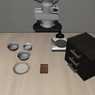
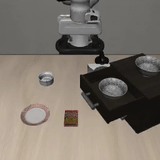

# LIBERO reproduction: SmolVLA (flow matching) vs pi0-FAST (tokenized actions)

Inference-only evaluation of two pretrained LIBERO policies with different action representations,
run through LeRobot's built-in LIBERO evaluator (`lerobot-eval --env.type=libero`). No training was done.
Everything below was measured on one shared aarch64 machine (NVIDIA GB10, unified memory) unless marked
"not measured".

| SmolVLA (flow matching) | pi0-FAST (tokenized actions) |
|---|---|
|  |  |

## Results (LIBERO-Spatial, 10 tasks x 10 episodes = 100 episodes, seed 1000)

With 100 episodes the 95% Wilson interval is about +/-9 points, so differences of a few points are not meaningful.

| Policy (checkpoint) | Action representation | Success | 95% CI | Published | Source of published number |
|---|---|---|---|---|---|
| SmolVLA 0.45B (`HuggingFaceVLA/smolvla_libero`, rev `6721902`) | flow matching, 50-step continuous chunk | **66/100 = 66.0%** | 56.3-74.5 | 90% (10 trials/task) | SmolVLA paper, arXiv 2506.01844, Table 2 |
| SmolVLA 0.45B (`lerobot/smolvla_libero`, rev `a24f1f3`) | same | **63/100 = 63.0%** | 53.2-71.8 | no number on model card | (paper number above is for the authors' own run) |
| pi0-FAST (`lerobot/pi0fast-libero-v044`, rev `2bb8d55`) | FAST: DCT + BPE tokens, autoregressive | **79/100 = 79.0%** | 70.0-85.8 | 82.5% averaged over all 4 suites (no per-suite figure) | model card of the checkpoint |

Per-task successes (out of 10) are in `results/*.json`; summary in `results/summary.csv`.

SmolVLA is about 24-27 points below its paper's LIBERO-Spatial number, outside the CI. I did not reproduce the
published SmolVLA figure. pi0-FAST scored 79% on Spatial against an 82.5% four-suite average (the per-suite
figures for this lerobot port are not published; I did not run the other three suites), so it is consistent with
the card but that is a weak check. On this single suite pi0-FAST is 13 points above SmolVLA (66%); the CIs
(70.0-85.8 vs 56.3-74.5) barely overlap, one seed. See "Gap vs published" below. The pi0-FAST published figure is an average over four
suites, so it is not a like-for-like comparison with a single-suite measurement.

### Inference latency (measured, shared machine, nice 19, one eval at a time)

Time per call that produces an action chunk, CUDA-synchronised, first call dropped. Includes
nothing from the simulator. Measured inside the real eval run (`scripts/eval_timed.py`).

| Policy | Median per chunk call | p95 | Calls | Actions executed per call |
|---|---|---|---|---|
| SmolVLA (`HuggingFaceVLA`, `n_action_steps=1`) | 0.157 s | 0.166 s | 16536 | 1 (re-plans every control step; predicts 50) |
| SmolVLA (`lerobot/smolvla_libero`, `n_action_steps=50`) | 0.089 s | 0.099 s | 391 | 50 (open loop) |
| pi0-FAST (`n_action_steps=10`, early stop on `|`) | 1.454 s | 1.840 s | 1573 | 10 |

SmolVLA latency is 10 Euler denoising steps over a 50-step chunk. The 0.157 vs 0.089 s difference between the
two SmolVLA runs was not investigated (different library versions of the same model class and machine load
differ; not measured separately).
pi0-FAST decodes autoregressively; lerobot decodes a fixed 256 tokens. I stop decoding at the end-of-action
token `|` (see "Deviations"). Unmodified decoder: 7.9 s per chunk (1 smoke episode, 28 calls, measured; raw file not kept), with the early stop
the same machine runs about 8 control steps/s.

## Reproduce

Two virtualenvs are needed (see "Why two environments").

```bash
# 1. SmolVLA env: lerobot 0.6.1
uv venv .venv --python 3.12
uv pip install --python .venv/bin/python "lerobot[libero,smolvla,pi]==0.6.1" sentencepiece
echo N | MUJOCO_GL=egl LIBERO_CONFIG_PATH=$PWD/.libero_cfg .venv/bin/python -c "import libero.libero"   # writes LIBERO config non-interactively
scripts/run_smolvla.sh libero_spatial 10 smolvla                                      # HuggingFaceVLA/smolvla_libero
POLICY=lerobot/smolvla_libero scripts/run_smolvla.sh libero_spatial 10 smolvla_lerobot_ckpt \
  --rename_map='{"observation.images.image":"observation.images.camera1","observation.images.image2":"observation.images.camera2"}'

# 2. pi0-FAST env: lerobot 0.4.4 + the transformers fork it requires
uv venv .venv044 --python 3.12
printf 'torch==2.11.0\ntorchvision==0.26.0\ntorchcodec==0.11.1\n' > /tmp/ov.txt   # keep the CUDA-13 aarch64 torch
uv pip install --python .venv044/bin/python --overrides /tmp/ov.txt "lerobot[libero]==0.4.4" sentencepiece
uv pip install --python .venv044/bin/python \
  "transformers @ git+https://github.com/huggingface/transformers.git@dcddb970176382c0fcf4521b0c0e6fc15894dfe0" "scipy>=1.10.1,<1.15"
# checkpoints + tokenizers (see "Deviations" for the tokenizer mirror)
.venv044/bin/python - <<'PY'
from huggingface_hub import snapshot_download as d
d("lerobot/pi0fast-libero-v044", revision="2bb8d5599b9cf8023ce9c110ba65af8e818fb4d3", local_dir="ckpt/pi0fast-libero-v044")
d("jadechoghari/fast-libero-tokenizer-mean-std", revision="09072b523fb583dce9c16da1327d691cf0504b58", local_dir="ckpt/fast_tokenizer")
d("nnh-pbbb/paligemma-3b-pt-224", revision="ee1ed4a8fbec4721cba08689648e02c4328f081c", local_dir="ckpt/paligemma_tokenizer",
  allow_patterns=["tokenizer*","special_tokens_map.json","added_tokens.json","config.json","preprocessor_config.json"])
PY
python3 - <<'PY'   # point the checkpoint at the local PaliGemma tokenizer
import json; p="ckpt/pi0fast-libero-v044/config.json"; c=json.load(open(p)); c["text_tokenizer_name"]="ckpt/paligemma_tokenizer"; json.dump(c,open(p,"w"),indent=2)
p="ckpt/pi0fast-libero-v044/policy_preprocessor.json"; s=open(p).read().replace('"google/paligemma-3b-pt-224"','"ckpt/paligemma_tokenizer"'); open(p,"w").write(s)
PY
VENV=.venv044 scripts/run_pi0fast.sh libero_spatial 10 pi0fast

# 3. results
.venv/bin/python scripts/summarize.py smolvla_libero_spatial=logs/smolvla_libero_spatial \
  smolvla_lerobot_ckpt_libero_spatial=logs/smolvla_lerobot_ckpt_spatial pi0fast_libero_spatial=logs/pi0fast_libero_spatial
PYTEST_DISABLE_PLUGIN_AUTOLOAD=1 .venv/bin/python -m pytest -q tests
```

Environment: Linux aarch64, torch 2.11.0+cu130, `MUJOCO_GL=egl`, MuJoCo 3.8.1, hf-libero 0.1.4 (lerobot 0.6.1 env)
/ 0.1.x (0.4.4 env). Versions: lerobot v0.6.1 = `7e241bd`, v0.4.4 = `8fff0fd`. All heavy runs used
`nice -n 19 ionice -c3`, 4 threads, `set_per_process_memory_fraction(0.3)`, one env, batch size 1
(`scripts/run_env.sh`, `scripts/eval_timed.py`). LIBERO max episode length in lerobot's evaluator is 280 steps.

### Why two environments

- `HuggingFaceVLA/smolvla_libero` runs on lerobot 0.6.1.
- `lerobot/pi0fast-libero-v044` did not work on 0.6.1. After the tokenizer issues below were worked around, the
  model loaded and ran, but its output began `Subtask: ...` instead of the `Action:` prefix that 0.6.1's
  decoder asserts (`AssertionError: Token sequence does not start with ['Action', ':']`). That points to a prompt/token
  format change between the lerobot version that produced the checkpoint (name suffix `v044`) and 0.6.1. I did not
  diagnose it further; I took the version named in the checkpoint (0.4.4) and it decodes correctly.
- 0.4.4's pi0 code requires a patched `transformers` (`fix/lerobot_openpi` branch; it raises "An incorrect transformer
  version is used" otherwise), hence the pinned git commit above. This is what the lerobot `[pi]` extra pins.

## Deviations from the checkpoints' stock setup (all affect reproducibility claims)

1. Gated tokenizer. The checkpoint references `google/paligemma-3b-pt-224`, which needs a gated HF login. I used
   the tokenizer files of the ungated mirror `nnh-pbbb/paligemma-3b-pt-224`. I could not compare them file-by-file with
   the gated originals; the model emits well-formed `Action:` token sequences with them, which suggests the vocabulary
   matches, but it is a possible source of error.
2. `AutoProcessor` workaround (`scripts/eval_timed.py`): with transformers 5.5.4 (lerobot 0.6.1 env) the FAST action
   processor failed to load from its repo. That is why I first tried 0.4.4's transformers; the same `AutoProcessor`
   monkeypatch builds `UniversalActionProcessor` by hand from the pinned repo files and is kept in the wrapper (harmless
   in the 0.4.4 env). The FAST processor code is from `jadechoghari/fast-libero-tokenizer-mean-std` (DCT, scale 10,
   BPE vocab 1024, horizon 10, action dim 7); I read it before running it.
3. Early stop on `|` for pi0-FAST decoding (speed only, output-identical by reading `detokenize_actions`, which
   discards everything after the first `|`). `EARLY_STOP=0` disables it. I did not run a bitwise A/B of actions.
4. `--rename_map` was needed to map the env camera keys to each policy's camera names.
5. Single seed (1000), `init_states=True` (LIBERO fixed initial states), hard resets (lerobot default).

## Gap vs published (SmolVLA, LIBERO-Spatial: 66% / 63% measured vs 90% in the paper)

Not diagnosed. Candidate causes, as hypotheses only:

1. Different checkpoints or training recipe. The paper's 90% is from the authors' own training run. Neither Hub
   checkpoint has a model card number, and `lerobot/smolvla_libero`'s `train_config.json` shows 25k steps at batch 32,
   which may be far less than the paper's schedule. (The `HuggingFaceVLA` checkpoint's training config was not checked.)
2. Chunk execution. The paper does not state `n_action_steps` for LIBERO. The two checkpoints ship with 1 and 50;
   they scored similarly (66 vs 63), so this alone is not obviously the cause, but 10 or 5 was not tried.
3. Image preprocessing: resize with padding to 512x512, camera naming/order, any 180-degree flip convention between
   the training dataset (`physical-intelligence/libero` derived) and lerobot's simulator observations.
4. Environment version: lerobot 0.6.1's LIBERO wrapper (control mode `relative`, observation keys, state layout)
   vs the code used for the paper.
5. Episode budget: 280 steps here (lerobot's setting); I believe the original LIBERO/openpi limit for Spatial is
   220, so a longer budget should not be a handicap. Task index 5 is the weakest in all three runs (0/10, 4/10 and
   1/10 for SmolVLA-lerobot, SmolVLA-HuggingFaceVLA and pi0-FAST), which suggests a task-specific failure (e.g.
   a hard layout or an ambiguous instruction) rather than uniform noise.
6. Seeds and init states: one seed; the paper's seed protocol is not stated. This cannot explain a 24-point gap with
   a +/-9 CI.
7. Library drift in transformers/SmolVLM2 weights between the paper date and now.

I ran one cheap A/B (`results/raw/smolvla_ab_n10_tasks3_5.eval_info.json`): `HuggingFaceVLA/smolvla_libero` with
`--policy.n_action_steps=10` instead of 1, tasks 3 and 5 only, 10 episodes each, same seed. Baseline (n=1) was 4/10 and
4/10; with n=10 it was 5/10 and 4/10. No visible effect (CIs about +/-30 points at n=10 per task), so chunk length is not
a strong lever for this gap, but this is a tiny test and does not rule it out. Median call latency 0.176 s.

## How the two policies work (from the code and configs; not re-measured unless stated)

| | SmolVLA (`lerobot` 0.6.1) | pi0-FAST (`lerobot` 0.4.4, checkpoint `pi05-fast` base) |
|---|---|---|
| Backbone | SmolVLM2-500M-Video-Instruct, first 16 LM layers used | PaliGemma (SigLIP vision tower + Gemma-2B), config `paligemma_variant=gemma_2b` |
| Parameters | 450M (safetensors count) | about 2.9B (safetensors count; 5.8 GB bf16) |
| Vision | 2 cameras (agentview, wrist) 256x256, resized with padding to 512x512 | 2 cameras 224x224 + 1 empty camera slot |
| Language | tokenized instruction, max 48 tokens | tokenized prompt, max 200 tokens |
| Proprioception | 8-d state, mean/std normalised, linearly projected into the token sequence (padded to 32) | 8-d state normalised to [-1,1], **discretised into 256 bins and written into the text prompt** (`Task: ..., State: ...;`) |
| Action output | action expert (width 0.75x of VLM, interleaved cross/self attention) predicts a continuous 50x7 chunk by **flow matching**, 10 Euler steps | model autoregressively emits discrete tokens: chunk of 10x7 actions -> DCT -> quantise (scale 10) -> BPE (1024 vocab) -> mapped onto PaliGemma vocab; greedy decoding, <= 256 tokens |
| Loss | flow-matching regression | next-token cross entropy |
| Executed per call | 1 or 50 of 50 (checkpoint dependent) | 10 of 10 |

Trade-offs, as I understand them from the code and papers (not experiments of mine except where numbers are given):

- Flow matching produces a whole continuous chunk in a fixed, small number of forward passes through a small expert, so
  latency is constant (0.09-0.16 s here) and independent of the action values. Quantisation error is absent, but a
  regression-style loss tends to average multimodal demonstrations.
- FAST turns control into language modelling, so a large pretrained VLM can be fine-tuned with its original loss, and
  sampling is naturally multimodal. The costs are sequential decoding (about 30-35 tokens per chunk here, one full
  Gemma forward each; 7.9 s per chunk when decoding the full 256 tokens), a fragile detokeniser (a malformed token
  sequence cannot be decoded, and the checkpoint needed the exact tokenizer and prompt format), and a 6x larger model.
- Why the results differ: I cannot attribute the difference to action representation from these runs. The two
  checkpoints differ in backbone size, pretraining, image resolution, training data pipeline and chunk length at the
  same time, and N=100 episodes gives +/-9 points.

## Modification experiments I would run next (not run)

1. Chunk-execution sweep on SmolVLA: `n_action_steps` in {1, 5, 10, 25, 50} on 3 fixed tasks (including task 5, which
   fails 0/10 and 4/10), 20 episodes each; isolates open-loop drift from per-task failure.
2. Denoising steps and noise: SmolVLA `num_steps` in {2, 5, 10, 20} to see whether the 0.09 s latency can be halved at
   equal success, and whether sampling noise explains part of the variance (fixed noise seed vs fresh).
3. FAST decoding: temperature 0 vs small sampling, and truncating `max_decoding_steps` to measure the
   latency/success curve; also swap the 256-bin state-in-prompt for no state to measure how much the model uses
   proprioception.
4. Same-backbone ablation (needs training; out of scope here): train both heads on one VLM to separate "action
   representation" from "backbone".

## Layout

- `scripts/eval_timed.py` wraps `lerobot-eval` and records per-chunk latency; `scripts/run_*.sh` are the exact commands.
- `scripts/summarize.py` builds `results/*.json` and `results/summary.csv` from `eval_info.json` (with Wilson CIs);
  `tests/test_summarize.py` checks it.
- `results/` per-task successes and timings; `docs/` rollout GIFs (`smolvla_spatial_task0_ep0.gif`: success; `pi0fast_spatial_task4_ep0.gif`; low-res, episode chosen as the first of the task, not selected for outcome beyond that); `logs/` raw eval output (gitignored except summaries).
